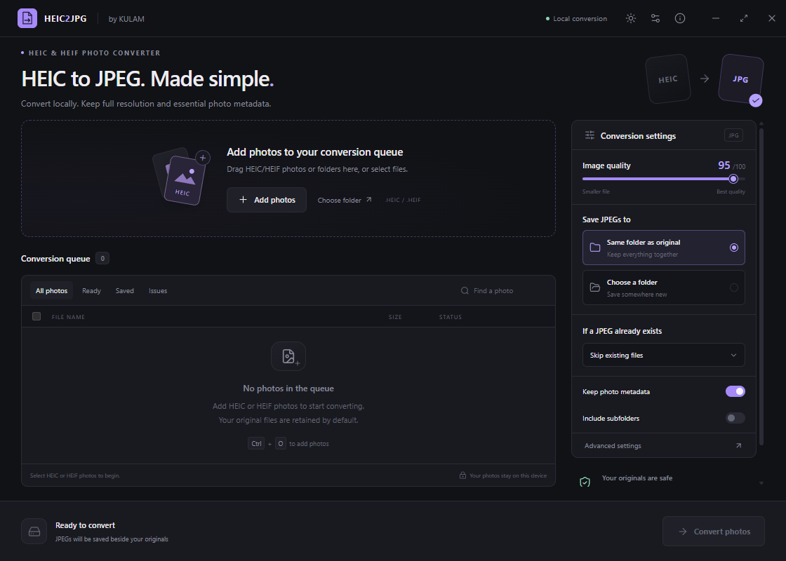
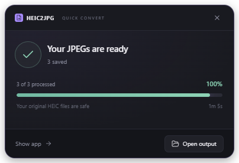
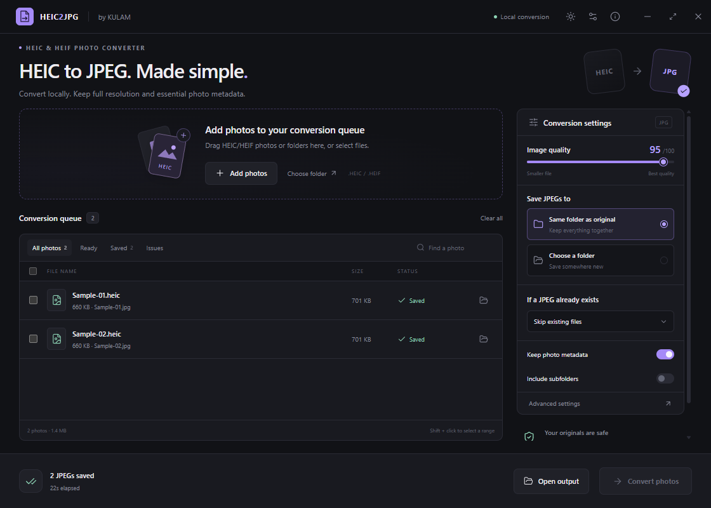

<p align="center">
  
</p>

<h1 align="center">HEIC2JPG</h1>

<p align="center">
  <strong>Convert HEIC photos directly from Windows Explorer.</strong><br>
  Select photos. Right-click <strong>Convert to JPG</strong>. Follow the compact progress window.
</p>

<p align="center">
  Local conversion on your Windows PC · Full-resolution output · Originals retained
</p>

<p align="center">
  <a href="https://github.com/jackingpanda/heic2jpg/releases/latest"><strong>Download for Windows</strong></a>
  &nbsp;·&nbsp; <a href="docs/GETTING_STARTED.md">Getting started</a>
  &nbsp;·&nbsp; <a href="CHANGELOG.md">Release notes</a>
  &nbsp;·&nbsp; <a href="https://github.com/jackingpanda/heic2jpg/issues/new/choose">Report a problem</a>
</p>

> Free for personal, non-commercial use. Share only unmodified official releases without charging. Application code is source-available under a custom license, not an open-source license. [Read the license](LICENSE).



## The most useful workflow: right-click and convert

1. Open HEIC2JPG once and enable **Add “Convert to JPG” to right-click** in Advanced settings.
2. Select HEIC/HEIF files or a folder in Explorer.
3. Right-click → **Convert to JPG**. On Windows 11, use **Show more options** if necessary.
4. Follow the small progress window, then select **Open output**.



The compact window shows the current file and stage, completed-file progress, elapsed time and a safe Stop action. Successful selections dismiss after eight seconds; errors remain available for review. Show app opens the full queue. Closing the small window hides it while conversion continues.

**Your originals stay in place.** Explorer conversions always retain source files. The classic Explorer menu has selection limits; for very large batches, select the folder or add it through the app.

## Features

| Workflow | What it does |
|---|---|
| Explorer integration | Convert selected files, a folder, or the current folder background. |
| Local conversion | No photo upload, account, codec-store purchase, or conversion server. |
| Batch queue | Virtualized rows, search, status filters, selection, retries and safe stopping. |
| Output control | Quality 1–100, JPEG 4:4:4, original/custom destination, naming modifiers and skip/rename/replace. |
| Metadata | Transfers writable EXIF, IPTC, XMP and ICC fields; verifies key camera/date/GPS fields and warns on problems. |
| Preferences | Persistent settings, modification-date preservation, dark/light themes and keyboard controls. |
| Updates | Automatic GitHub checks and manual Check for updates. Download and restart/install require your action. |
| Support | In-app email/issue draft form, optional basic diagnostics, privacy notice and release history. |

## Install and update

Windows x64 is the supported target. Development and local validation use Windows 11; a Windows 10 clean-machine compatibility matrix is not yet complete.

1. Download `HEIC2JPG-Setup-<version>.exe` from [GitHub Releases](https://github.com/jackingpanda/heic2jpg/releases/latest).
2. Run the installer and review the personal-use license.
3. Choose an installation location and finish setup. The progress page names the current installation phase and displays activity details.
4. Launch the app and enable the Explorer menu if you want right-click conversion.

**Updating an installed copy:** finish conversion, choose Quit from the tray menu, then run the new installer in the same location. Do not uninstall manually first. Preferences are reused, and the installer restores an existing Explorer integration preference. Versions 1.0/1.1 need this manual upgrade once before the in-app GitHub updater becomes available.

Current installers are unsigned. Only use official release assets. For a folder-based run, keep the entire `win-unpacked` folder together; the setup installer is recommended for normal use and future updates.

## Using the full application

1. Add photos or folders using drag/drop, Add photos, or Choose folder.
2. Review the queue and choose quality, destination and existing-file behavior.
3. Convert all ready photos, or select rows and convert that selection.
4. Open output, review any warnings, or prepare failed photos for retry.



Defaults are quality 95, output beside the source, skip existing JPEGs, preserve metadata and modification dates, keep originals, and no recursive scan. The queue is session-only. Stop after current finishes active photos and leaves unstarted items resumable. Moving originals to the Recycle Bin is optional, requires confirmation for each GUI batch, and is disabled for Explorer conversion.

### Image and metadata limits

JPEG is lossy, including at quality 100. Export is the primary still exposed by the decoder, at full resolution as an 8-bit JPEG. Transparency becomes white. HEIF container transforms and EXIF-only orientation are handled before the output orientation is normalized.

Metadata preservation does not guarantee every vendor field, HDR/gain map, depth map or Live Photo video. Warnings prevent automatic recycling of the original. Keep HEIC originals for archival use. Input limits are 150 MB and 100 megapixels; a worker times out after two minutes. Real-device HDR/wide-gamut/mirrored samples and very large conversion benchmarks remain release-validation work.

## About, updates and reports

Open the information icon in the title bar for **About & updates**, **Report a problem**, and **Release notes**. Automatic checking contacts the public GitHub release feed at startup and about every six hours while the app is running and idle. It never downloads or installs an update without your action.

The report form opens a reviewed email draft or GitHub issue draft, or copies the report. It does not send messages automatically and attaches no photos, EXIF, file paths, settings or logs. Basic version/platform diagnostics are optional. GitHub issues are public; security concerns should go to email.

- Developer: **KULAM**
- Website: [www.kulam.my.id](https://www.kulam.my.id)
- Support and reports: [heic2jpg@kulam.my.id](mailto:heic2jpg@kulam.my.id)
- [Privacy notice](PRIVACY.md) · [Security reporting](SECURITY.md)

## Keyboard shortcuts

| Shortcut | Action |
|---|---|
| Ctrl+O | Add photos |
| Ctrl+Shift+O | Add a folder |
| Ctrl+Enter | Convert ready or selected photos |
| Escape | Stop after active photos finish |
| Ctrl+A | Select visible queue rows |
| Shift+click checkbox | Select a range |
| Delete | Remove selected queue rows |
| Ctrl+, | Advanced settings |
| F5 | Prepare failed photos for retry |

## Development and verification

Maintainers need Windows x64 and Node.js 24 LTS. Existing third-party rights and authorized maintenance are preserved; source availability does not grant unrelated modification or commercial-use rights in KULAM material.

```powershell
npm ci
npm run release:check
npm test
npm run build
npm run test:ui
npm run test:progress
npm run package
```

`npm run dev` starts development. UI tests need a completed build and should run sequentially, without rebuilding at the same time. They use public fixtures and isolated profiles. `node scripts/prepare-fixtures.cjs` restores the public fixture if missing; `npm run prepare:installer` regenerates matching icons, license notices and checked NSIS phase customization.

- [Maintainer release procedure](docs/RELEASING.md)
- [Screenshot tutorial](docs/GETTING_STARTED.md)
- [Architecture and original product intent](docs/ARCHITECTURE.md)
- [Verification reports](docs/VERIFICATION.md)
- [License structure and review notes](legal/README.md)

`releases/history.json` is the source for CHANGELOG.md, GitHub release notes and the in-app history. Run `npm run release:notes` after updating it. Tags matching `v<package-version>` trigger the Windows release workflow, which publishes the installer, block map and `latest.yml` update manifest. Never commit installers, credentials or signing certificates to Git.

## License and third-party software

From 1.2.0 onward, KULAM application material is covered by the **KULAM Personal Use License 1.0**: personal/non-commercial use and free sharing of complete, unmodified official releases. No unrelated modification, commercial use, paid distribution or rebranding is permitted without written permission.

These terms do not revoke earlier MIT grants for versions 1.0.0/1.1.0 or override third-party licenses and mandatory legal rights. LGPL replacement, debugging and relinking rights remain available where required. See [LICENSE](LICENSE), [third-party notices](THIRD_PARTY_NOTICES.md), and [source/replacement information](THIRD_PARTY_SOURCES.md).

© 2026 KULAM. Third-party copyrights and licenses remain with their respective owners.
