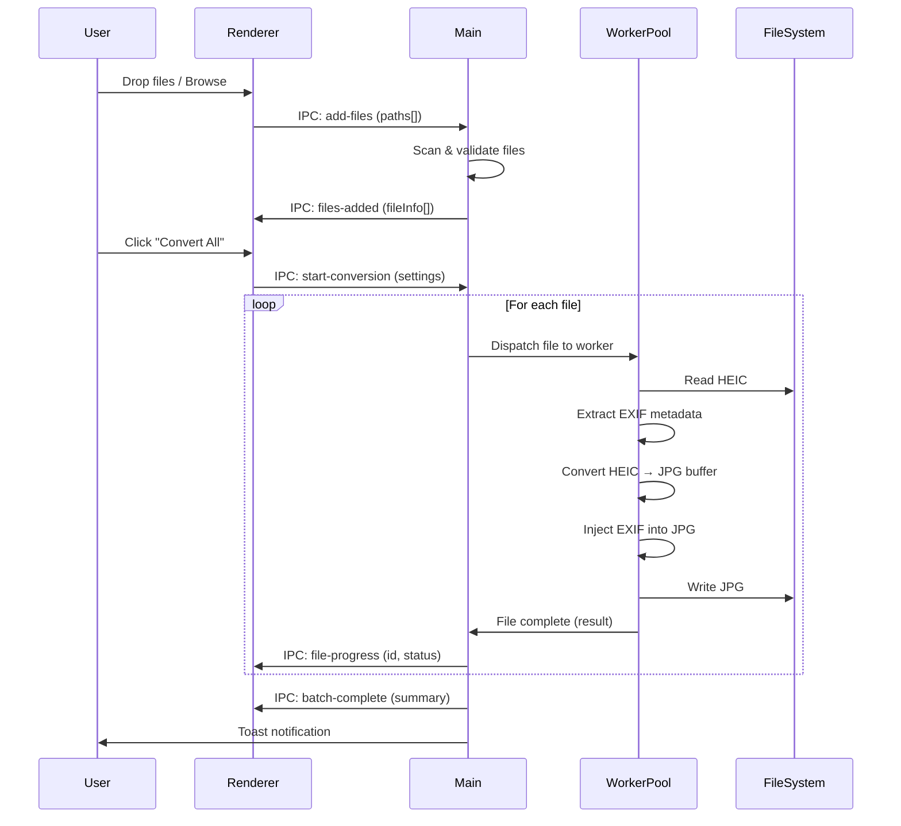
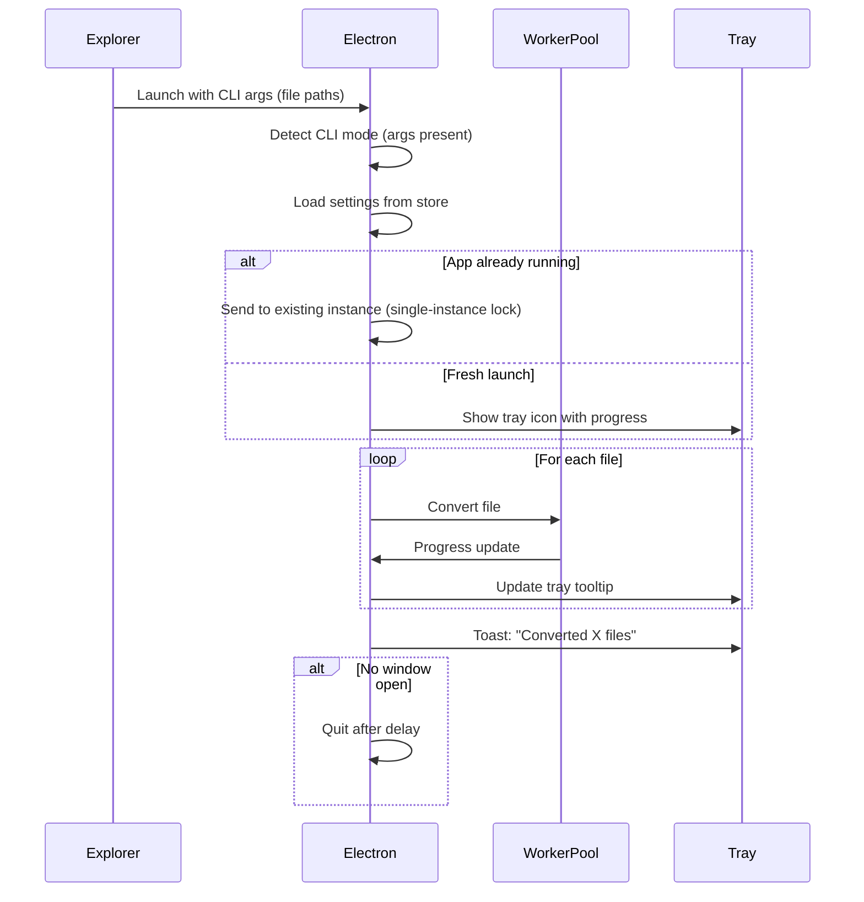

# Technical Architecture Document
# HEIC2JPG Converter

---

## 1. Technology Stack

| Layer | Technology | Alasan |
|-------|-----------|--------|
| **Runtime** | Electron 33+ | Cross-platform desktop, chromium renderer, Node.js backend |
| **Language** | TypeScript | Type safety, better DX, catch errors di compile time |
| **UI Framework** | React 18 | Component-based, virtual DOM, ecosystem maturity |
| **Bundler** | Vite + electron-vite | Fast HMR, ESM native, optimal build |
| **HEIC Decoder** | `sharp` (primary) + `heic-convert` (fallback) | Sharp = native libvips binding (fast), heic-convert = pure JS fallback |
| **Metadata** | `exifr` (read) + `piexif-ts` (write) | Extract EXIF dari HEIC, inject ke JPEG |
| **Worker** | Node.js `worker_threads` | Off-main-thread processing, true parallelism |
| **UI Virtualization** | `@tanstack/react-virtual` | Virtual scroll untuk file list 10K+ items |
| **State Management** | Zustand | Minimal, performant, no boilerplate |
| **Styling** | CSS Modules + CSS Variables | Scoped styles, theming via variables |
| **Installer** | electron-builder (NSIS) | Windows installer with registry hooks |
| **Context Menu** | Windows Registry via `regedit` module | HKCU-based, no admin required |

---

## 2. Architecture Overview

```
┌─────────────────────────────────────────────────────────┐
│                    Electron App                          │
│                                                         │
│  ┌──────────────┐         ┌───────────────────────┐     │
│  │  Renderer     │  IPC    │  Main Process          │     │
│  │  (React UI)   │◄──────►│                        │     │
│  │               │        │  ┌──────────────────┐  │     │
│  │  - Drop Zone  │        │  │ ConversionManager│  │     │
│  │  - File Queue │        │  │                  │  │     │
│  │  - Settings   │        │  │  ┌────────────┐  │  │     │
│  │  - Progress   │        │  │  │ Worker Pool│  │  │     │
│  │               │        │  │  │            │  │  │     │
│  │               │        │  │  │ W1 W2 W3 W4│  │  │     │
│  │               │        │  │  └────────────┘  │  │     │
│  │               │        │  └──────────────────┘  │     │
│  │               │        │                        │     │
│  │               │        │  ┌──────────────────┐  │     │
│  │               │        │  │ ContextMenu      │  │     │
│  │               │        │  │ Registry Manager │  │     │
│  │               │        │  └──────────────────┘  │     │
│  │               │        │                        │     │
│  │               │        │  ┌──────────────────┐  │     │
│  │               │        │  │ Tray / Notif     │  │     │
│  │               │        │  └──────────────────┘  │     │
│  └──────────────┘         └───────────────────────┘     │
└─────────────────────────────────────────────────────────┘
```

---

## 3. Module Breakdown

### 3.1 Main Process (`src/main/`)

```
src/main/
├── index.ts                 # Entry point, app lifecycle
├── window.ts                # BrowserWindow management
├── ipc-handlers.ts          # IPC message handlers
├── conversion/
│   ├── manager.ts           # Orchestrates conversion queue
│   ├── worker.ts            # Worker thread script
│   ├── converter.ts         # Core HEIC→JPG conversion logic
│   ├── metadata.ts          # EXIF extract & inject
│   └── file-scanner.ts      # Scan folders for HEIC files
├── context-menu/
│   ├── registry.ts          # Windows Registry read/write
│   └── cli-handler.ts       # Handle CLI args from context menu
├── settings/
│   └── store.ts             # Persistent settings (electron-store)
└── notifications.ts         # System tray & toast notifications
```

### 3.2 Renderer Process (`src/renderer/`)

```
src/renderer/
├── index.html
├── main.tsx                 # React entry point
├── App.tsx                  # Root component
├── components/
│   ├── DropZone/
│   │   ├── DropZone.tsx     # Drag & drop area
│   │   └── DropZone.module.css
│   ├── FileQueue/
│   │   ├── FileQueue.tsx    # Virtual-scrolled file list
│   │   ├── FileRow.tsx      # Individual file row
│   │   └── FileQueue.module.css
│   ├── ProgressBar/
│   │   ├── OverallProgress.tsx
│   │   └── ProgressBar.module.css
│   ├── Settings/
│   │   ├── SettingsPanel.tsx
│   │   ├── QualitySlider.tsx
│   │   ├── OutputConfig.tsx
│   │   └── Settings.module.css
│   ├── TitleBar/
│   │   ├── TitleBar.tsx     # Custom title bar
│   │   └── TitleBar.module.css
│   └── common/
│       ├── Button.tsx
│       ├── Toggle.tsx
│       ├── Tooltip.tsx
│       └── common.module.css
├── hooks/
│   ├── useConversion.ts     # Conversion state & actions
│   ├── useDragDrop.ts       # Drag & drop logic
│   └── useSettings.ts       # Settings state
├── store/
│   └── appStore.ts          # Zustand store
├── styles/
│   ├── global.css           # Global styles, CSS variables
│   ├── theme.css            # Dark/light theme tokens
│   └── animations.css       # Shared animations
├── types/
│   └── index.ts             # Shared TypeScript types
└── utils/
    ├── format.ts            # File size formatting, etc.
    └── ipc.ts               # IPC wrapper utilities
```

### 3.3 Shared (`src/shared/`)

```
src/shared/
├── types.ts                 # Types shared between main & renderer
├── constants.ts             # App constants, default settings
└── ipc-channels.ts          # IPC channel name constants
```

---

## 4. Data Flow

### 4.1 Normal UI Flow



### 4.2 Context Menu Flow



---

## 5. Conversion Pipeline Detail

```
Input HEIC File
       │
       ▼
┌──────────────┐
│ Read buffer   │  fs.readFile (async)
└──────┬───────┘
       │
       ▼
┌──────────────┐
│ Extract EXIF  │  exifr.parse(buffer) → full metadata object
│ from HEIC     │  exifr.thumbnailBuffer(buffer) → thumbnail
└──────┬───────┘
       │
       ▼
┌──────────────┐
│ Decode HEIC   │  sharp(buffer) or heic-convert
│ to raw pixels │  
└──────┬───────┘
       │
       ▼
┌──────────────┐
│ Encode JPEG   │  sharp.jpeg({ quality, chromaSubsampling: '4:4:4' })
│ (max quality) │  keepMetadata: false (we inject manually)
└──────┬───────┘
       │
       ▼
┌──────────────┐
│ Inject EXIF   │  piexif-ts: insert EXIF bytes into JPEG APP1 segment
│ into JPEG     │  Preserves: GPS, Camera, DateTime, Orientation, etc.
└──────┬───────┘
       │
       ▼
┌──────────────┐
│ Validate      │  Compare EXIF fields: source vs output
│ metadata      │  Log any missing fields
└──────┬───────┘
       │
       ▼
┌──────────────┐
│ Write output  │  fs.writeFile (async)
│ .jpg file     │  Preserve original file timestamps if configured
└──────────────┘
```

---

## 6. Worker Thread Architecture

### Pool Design

```typescript
// Pseudo-code for worker pool
class ConversionPool {
  private workers: Worker[];
  private queue: ConversionJob[];
  private concurrency: number;  // os.cpus().length - 1

  constructor() {
    this.concurrency = Math.max(1, os.cpus().length - 1);
    this.workers = Array.from(
      { length: this.concurrency },
      () => new Worker('./worker.ts')
    );
  }

  async processQueue(): Promise<BatchResult> {
    // Round-robin dispatch to available workers
    // Each worker processes one file at a time
    // Main thread stays free for IPC & UI updates
  }

  cancel(): void {
    // Terminate all workers
    // Spawn fresh workers for next batch
  }
}
```

### Worker Script

```typescript
// worker.ts — runs in separate thread
import { parentPort, workerData } from 'worker_threads';
import { convertFile } from './converter';
import { extractMetadata, injectMetadata } from './metadata';

parentPort?.on('message', async (job: ConversionJob) => {
  try {
    const metadata = await extractMetadata(job.inputPath);
    const jpegBuffer = await convertFile(job.inputPath, job.quality);
    const finalBuffer = await injectMetadata(jpegBuffer, metadata);
    
    await fs.promises.writeFile(job.outputPath, finalBuffer);
    
    parentPort?.postMessage({ 
      id: job.id, 
      status: 'done',
      outputPath: job.outputPath,
      outputSize: finalBuffer.length 
    });
  } catch (error) {
    parentPort?.postMessage({ 
      id: job.id, 
      status: 'error', 
      error: error.message 
    });
  }
});
```

---

## 7. IPC Channel Design

| Channel | Direction | Payload | Purpose |
|---------|-----------|---------|---------|
| `files:add` | R→M | `string[]` (paths) | Add files/folders to queue |
| `files:added` | M→R | `FileInfo[]` | Confirmed file list |
| `files:clear` | R→M | — | Clear queue |
| `convert:start` | R→M | `ConversionSettings` | Start batch |
| `convert:progress` | M→R | `{ id, status, progress }` | Per-file update |
| `convert:complete` | M→R | `BatchResult` | Batch finished |
| `convert:cancel` | R→M | — | Cancel current batch |
| `settings:get` | R→M | — | Request settings |
| `settings:set` | R→M | `Settings` | Update settings |
| `settings:value` | M→R | `Settings` | Settings response |
| `dialog:folder` | R→M | — | Open folder picker |
| `dialog:files` | R→M | — | Open file picker |
| `dialog:result` | M→R | `string[]` | Picker result |
| `context-menu:register` | R→M | — | Register context menu |
| `context-menu:unregister` | R→M | — | Remove context menu |

---

## 8. Settings Persistence

Menggunakan `electron-store` untuk settings yang persist antar sesi:

```typescript
interface AppSettings {
  // Conversion
  quality: number;              // 1-100, default: 95
  outputMode: 'same' | 'custom';
  customOutputPath: string;
  namingPattern: 'keep' | 'suffix' | 'prefix';
  namingSuffix: string;         // default: ''
  namingPrefix: string;         // default: ''
  conflictMode: 'skip' | 'overwrite' | 'rename';
  deleteOriginals: boolean;     // default: false
  scanSubfolders: boolean;      // default: false
  
  // UI
  theme: 'dark' | 'light';     // default: 'dark'
  windowBounds: Rectangle;
  
  // Context Menu
  contextMenuEnabled: boolean;  // default: true
  silentMode: boolean;          // default: true (for context menu)
  
  // Advanced
  maxConcurrency: number;       // default: auto (cores - 1)
  preserveTimestamps: boolean;  // default: true
}
```

---

## 9. Error Handling Strategy

```
Error terjadi di Worker
       │
       ▼
┌────────────────────┐
│ Worker catches      │
│ - Decode error      │  → "Cannot decode HEIC: corrupt or unsupported"
│ - Memory error      │  → "File too large for available memory"
│ - Permission error  │  → "Cannot write to output directory"
│ - Metadata error    │  → "Metadata extraction failed (convert anyway)"
└──────┬─────────────┘
       │
       ▼
┌────────────────────┐
│ Worker reports      │
│ error to Main       │  → { id, status: 'error', error: message }
└──────┬─────────────┘
       │
       ▼
┌────────────────────┐
│ Main Process        │
│ - Log to file       │  → %APPDATA%/heic2jpg/logs/
│ - Update file status│
│ - Continue batch    │  → Next file in queue
└──────┬─────────────┘
       │
       ▼
┌────────────────────┐
│ Renderer shows      │
│ - Error icon on row │
│ - Tooltip with msg  │
│ - Summary at end    │  → "25/27 converted, 2 errors"
└────────────────────┘
```

---

## 10. Build & Distribution

### Build Pipeline

```bash
# Development
npm run dev              # electron-vite dev server + HMR

# Production build
npm run build            # TypeScript compile + Vite bundle
npm run package          # electron-builder → .exe installer

# Output
dist/
├── win-unpacked/        # Portable version
├── HEIC2JPG-Setup.exe   # NSIS installer
└── latest.yml           # Auto-update manifest (future)
```

### Installer Hooks

NSIS installer melakukan:
1. Install app ke `%LOCALAPPDATA%\HEIC2JPG\`
2. Register context menu di Registry (`HKCU`)
3. Create Start Menu shortcut
4. Create Desktop shortcut (optional)

Uninstaller melakukan:
1. Remove app files
2. **Remove registry entries** (context menu cleanup)
3. Remove shortcuts
4. Remove settings (optional, ask user)

---

## 11. Security Considerations

| Concern | Mitigation |
|---------|-----------|
| Arbitrary file read | Only read `.heic`/`.heif` extensions, validate magic bytes |
| Path traversal | Sanitize all file paths, resolve to absolute |
| Registry tampering | Only write to HKCU (user scope), validate paths |
| Large file DoS | Per-file memory limit, timeout per conversion |
| Untrusted EXIF data | Pass through as-is (binary copy), no interpretation |
