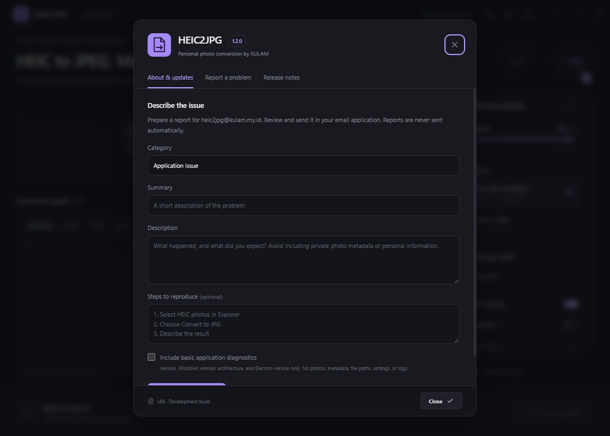

# Getting started

## Install or update

1. Open [GitHub Releases](https://github.com/jackingpanda/heic2jpg/releases/latest) and download the Windows x64 setup executable.
2. For an update, finish conversion and choose Quit from the HEIC2JPG tray menu first.
3. Run the installer, review the personal-use license, and keep the existing installation location when updating.
4. The installation page explains whether it is preparing the previous version, extracting application/conversion tools, or configuring Windows integration. The expanded detail log shows activity. Do not close the installer while it is working.
5. Launch HEIC2JPG. Your existing preferences are reused. New installations keep original photos by default.

Windows builds are currently unsigned. Only use official release assets. There is no account or codec-store purchase required for conversion.

## Recommended: convert from Windows Explorer

1. Open Advanced settings in HEIC2JPG and enable **Add “Convert to JPG” to right-click**.
2. In Explorer, select HEIC/HEIF photos, a folder, or a folder background.
3. Right-click and choose **Convert to JPG**. On Windows 11, open **Show more options** if needed.
4. Follow the compact progress window. It shows the active file and stage, true completed-file progress, elapsed time and a Stop action.
5. Select **Open output** when finished. Successful sessions dismiss after eight seconds. Errors stay visible for review through **Show app**.

The original HEIC files are always retained for Explorer conversions. Existing-file behavior follows your saved settings. For more than the classic shell's selection limit, select the folder or add it through the app instead.

## Convert inside the app

1. Add photos or folders through drag/drop, Add photos, or Choose folder.
2. Select quality, destination and existing-file behavior. Quality 95 is the default. JPEG remains a lossy format, including at quality 100.
3. Choose Convert photos, or select rows and Convert selected.
4. Review progress, errors and output. Retry errors prepares failed photos for another attempt. Stopped photos can be resumed from the queue.

## Updates, support and licensing

Open **About and updates** from the information icon in the title bar. Automatic checks use GitHub at startup and every six hours while the app is running and idle. Downloading and restarting to install are explicit actions. No photos are sent to GitHub for conversion.

Use **Report a problem** to prepare a report. Diagnostics are optional. Open email draft uses your default email application and never sends automatically; review the content and send it yourself. Copy report works if no email app is configured. GitHub issues are public; use email for security concerns. Contact: heic2jpg@kulam.my.id.

Personal, non-commercial use only for KULAM application material from 1.2.0 onward. Share only unmodified official builds without charging. See LICENSE for third-party rights and prior-license exceptions.

## Uninstall

Use Windows Settings → Apps → HEIC2JPG → Uninstall. This removes the application and Explorer menu entries. Photo files stored outside the application's installation folder are not an uninstall target.
